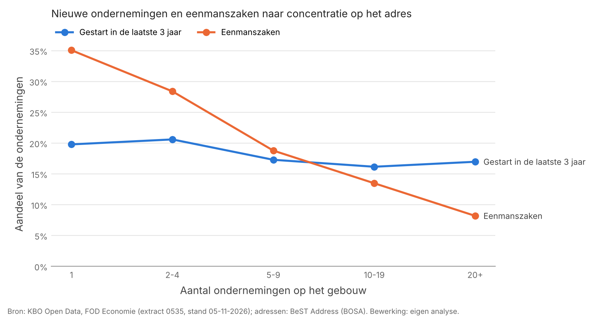

# Adresconcentraties van ondernemingen in de regio Antwerpen

*Een verkenning met open bronnen · Jeroen · november 2026*

## Vraag

Welke adressen in de regio Antwerpen vertonen opvallende concentraties van ondernemingen, en hoeveel daarvan blijven onverklaard na controle in open bronnen? Concentraties van ondernemingen op één adres zijn een bekend signaal bij ondermijning en brievenbusconstructies, maar ook het normale beeld bij boekhoudkantoren en ondernemingscentra. Dit project gaat na hoe goed zo'n signaal het een van het ander kan scheiden.

## Bronnen

- **KBO Open Data** (FOD Economie), volledig extract 0535, stand 5 november 2026: alle actieve ondernemingen, vestigingen, adressen, contactgegevens en activiteiten (NACE). Gebruikt onder de licentie *Open Data: gebruiksvoorwaarden*, voor niet-commercieel onderzoek.
- **BeST Address** (BOSA/NGI): het officiële Belgische adressenregister, met coördinaten en adreseenheden (busnummers).
- Voor de handmatige controle: Belgisch Staatsblad, jaarrekeningen (NBB) en Street View.

Studiegebied: de provincie Antwerpen (postcodes 2000–2999) en het havengebied op Linkeroever (9120, 9130).

## Werkwijze

1. **Inladen en normaliseren** van het KBO-extract; adressen teruggebracht tot een gebouwsleutel (postcode, straat, huisnummer).
2. **Koppeling aan BeST** in vier stappen met oplopende onzekerheid: exact, huisnummer zonder toevoeging, straatnaam met spellingvariant, en andere postcode. Wat niet koppelt, wordt ingedeeld naar oorzaak.
3. **Profiel van concentratieadressen** vergeleken met gewone adressen.
4. **Eén expliciete selectieregel** in plaats van een risicoscore, gevolgd door handmatige controle van de vijftien hoogst scorende adressen.

De code staat in drie notebooks in deze repository. Ruwe data, adressen en namen staan er niet in.

## Resultaten

### 1. De KBO-adressen zijn goed bruikbaar, met een herkenbaar patroon in de fouten

Van de 216.143 gebouwen met minstens één onderneming in het studiegebied kon 96,7% aan het officiële adressenregister worden gekoppeld (97,1% gewogen naar ondernemingen); 82,7% exact.

Twee observaties over de bron zelf:

- Bij 8,3% was een correctie van de straatnaam nodig. In de gevallen die ik heb nagekeken, was de oorzaak bijna altijd dat de KBO de **deelgemeente als afkorting achter de straatnaam** zet (`BREDABAAN CENTRUM`, `ROSSEM NDW`) en BeST niet. Waar een straatnaam binnen één postcode in twee deelgemeenten voorkomt, is die toevoeging het enige onderscheid.
- Van de 3,4% die niet koppelt, gaat het in vier op de vijf gevallen om een **huisnummer dat niet (meer) in het officiële register voorkomt**. Dat kan sloop, hernummering of een foute inschrijving zijn, en is op zichzelf een aanknopingspunt.

### 2. Concentratieadressen zijn vooral gevestigde tussenpersonen

Hoe meer ondernemingen op een gebouw, hoe kleiner het aandeel eenmanszaken (35% op adressen met één onderneming, 8% bij twintig of meer) en hoe meer verschillende sectoren (gemiddeld 12,6 NACE-afdelingen bij twintig of meer). Het aandeel recent opgerichte ondernemingen stijgt *niet* met de concentratie. Dat is het profiel van boekhoudkantoren, domiciliëringsadressen en ondernemingscentra, niet van clusters nieuw opgerichte vennootschappen.

**Gevolg voor de methode:** een score die concentratie als zodanig beloont, zou vooral die legitieme tussenpersonen rangschikken. Ik heb daarom gezocht naar afwijkingen *binnen* de concentraties.

### 3. Selectie en handmatige controle

Regel: minstens tien ondernemingen op het gebouw, waarvan minstens de helft in de laatste drie jaar gestart. Dat selecteert 54 van de 1.224 gebouwen met tien of meer ondernemingen. De vijftien met de meeste recente starts heb ik bekeken.

| Voorlopige indeling | Adressen |
|---|---|
| Fondsen, holdings en projectvennootschappen van één groep | 6 |
| Woongebouw of gemengd gebouw (verenigingen van mede-eigenaars) | 3 |
| Ondernemingscentrum / domiciliëring | 1 |
| Waarschijnlijk gedeelde woning (zie hieronder) | 1 |
| Nog niet verklaard | 4 |

De indeling is gebaseerd op de registergegevens (namen van rechtspersonen, rechtsvorm, sector, startdata); verificatie in het Staatsblad en via Street View loopt nog voor de vier niet-verklaarde adressen.

**Belangrijkste les:** de regel "veel recente starts" pikt vooral groepen entiteiten op die samen zijn opgericht, zoals investeringsfondsen en bouwprojecten. De meeste treffers zijn binnen enkele minuten te verklaren. Een bruikbare indicator moet die structuren eerst uitsluiten, bijvoorbeeld op basis van gedeelde naamstammen of gedeelde bestuurders.

### 4. Het meest opvallende adres, en waarom ik daar stop

Eén adres wijkt duidelijk af van de rest: ruim tien eenmanszaken in de bouwsector (NACE 41 en 43), allemaal ingeschreven tussen april en juni 2026, waarvan vijf in dezelfde week, op een gebouw met één adreseenheid in BeST. Geen van deze ondernemingen heeft contactgegevens of een vestiging elders.

Voor een eenmanszaak is het KBO-adres doorgaans het woonadres. De meest waarschijnlijke lezing is daarom een gedeelde woning van nieuwe zelfstandigen in de bouw, ingeschreven via één tussenpersoon. Hetzelfde patroon past ook bij constructies rond schijnzelfstandigheid in onderaannemingsketens, maar open bronnen kunnen die twee niet onderscheiden.

**Ik ga hier bewust niet verder**, om drie redenen:

- Het adres is vrijwel zeker een privéwoning van identificeerbare personen. Verder zoeken (de afzonderlijke inschrijvingen, de woning, de personen) verschuift het onderzoek van een patroon in een register naar specifieke mensen.
- Daarvoor heb ik geen grondslag. Ik heb de KBO-gegevens gekregen voor onderzoek naar registratiepatronen en ben onder de AVG verantwoordelijk voor de persoonsgegevens erin.
- De vraag die dit adres oproept, is alleen te beantwoorden met gegevens die open bronnen niet bevatten (sociale zekerheid, detacheringsmeldingen, arbeidsrelaties). Dat is het terrein van de sociale inspectiediensten.

Dit adres wordt daarom nergens met adres, postcode of namen beschreven.

## Beperkingen

- Eén momentopname van actieve ondernemingen: geen historiek en geen stopgezette ondernemingen. Verloop op een adres is niet te meten.
- Bestuurders zitten niet in de open KBO-data, waardoor groepsstructuren alleen via namen zichtbaar zijn.
- Een adreseenheid in BeST is een registereenheid, geen vloeroppervlak: een gebouw met één eenheid kan een groot kantoor zijn.
- Netwerkanalyse via gedeelde adressen en contactgegevens leverde één reuzencomponent op (16.464 ondernemingen): tussenpersonen als boekhouders en webbouwers verbinden alles met alles. Zonder strengere drempels is dat niet bruikbaar en het is daarom niet gebruikt.
- De selectieregel is op vijftien adressen getest; dat is een eerste indruk, geen validatie.

## Wat ik hieruit meeneem

Het grootste deel van het werk zat niet in de analyse maar in het beoordelen van de bron: hoe betrouwbaar zijn de adressen, welke conventies gebruikt het register, wat betekent een concentratie eigenlijk. De meeste opvallende signalen hadden een gewone verklaring, en het ene adres dat bleef staan, liet vooral zien waar open-bronnenonderzoek moet ophouden.

---

*Bron: KBO Open Data, FOD Economie, K.M.O., Middenstand en Energie (extract 0535, stand 05-11-2026); BeST Address (BOSA). Bewerking en interpretatie: eigen analyse. Geen enkele bevinding in dit rapport is een vaststelling van onregelmatigheden.*
